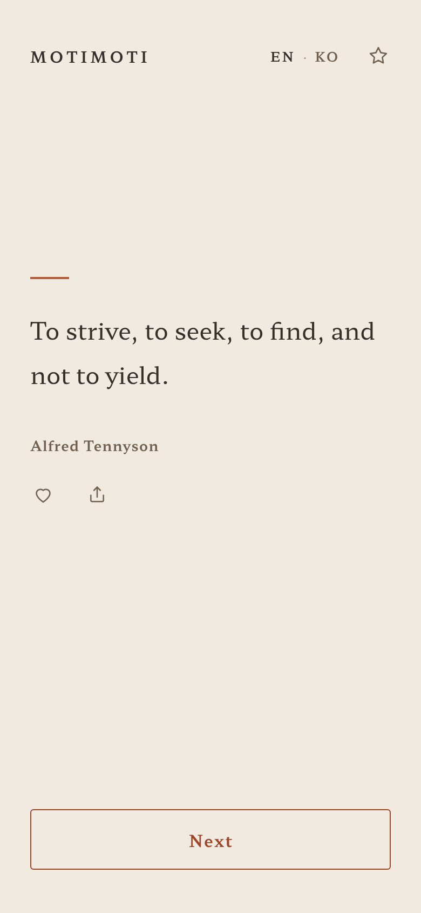
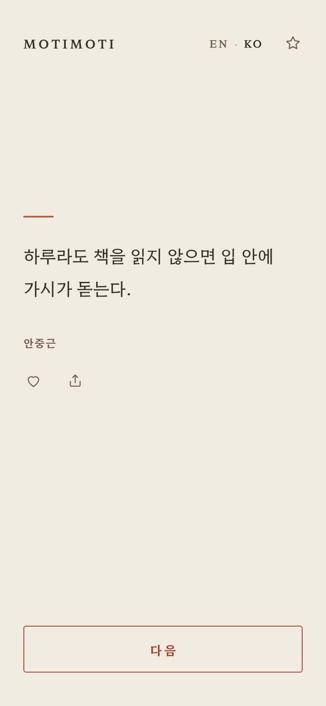
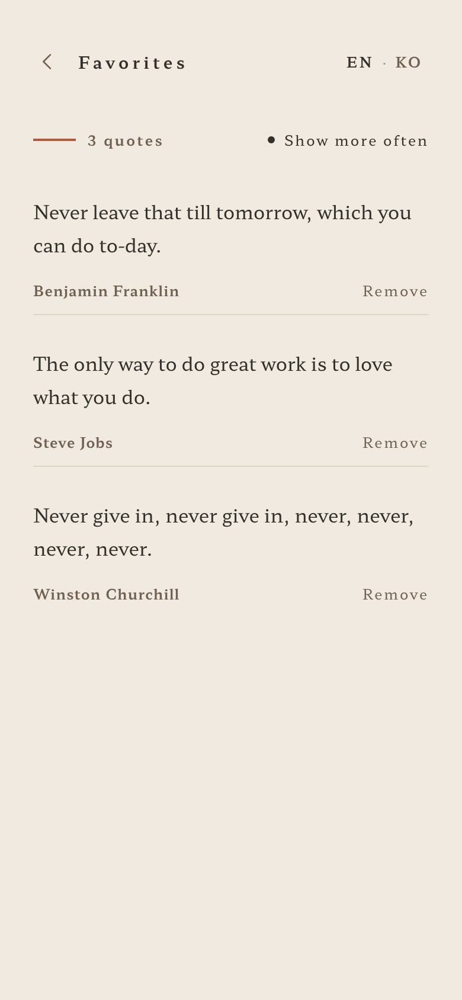

# moti

**motimoti** — a bilingual (English / Korean) quote app, and the **collector** used to admit quotes into it.

Every quote is traced to a primary source before it ships. No "attributed to", no quote-site copy-paste.

- **App** — https://sumokmax-proj.github.io/moti/
- **Collector** — https://sumokmax-proj.github.io/moti/collector/ (read-only on Pages; see [Collector](#collector))
- **한국어 문서** — [README.ko.md](README.ko.md)

| App (English) | App (Korean) | Favorites |
|---|---|---|
|  |  |  |

---

## Features

**Reading**

- One quote at a time, drawn at random. **Next** cross-fades to another.
- **Recently-seen avoidance** — the last 20% of the pool (20 quotes out of 100) is skipped, and the list is **persisted across sessions**, so yesterday's last quote isn't today's first.
- **Riffle** — hold **Next** for 400 ms (or swipe left on the quote) and 4–7 paper sheets flip past, thumb-riffle style, speeding up then settling over 800 ms. Tap anywhere to pin it mid-flight. Keyboard: `Shift` + `→`.
- **Back one page** — swipe right (or `←`) un-folds the previous sheet from the spine. Exactly one page back, and it survives a reload. At the dead end the page lifts 22 px and settles with a slight overshoot, so the limit is felt rather than silent.
- **Auto-fit** — on small screens the body text steps down 1 px at a time until the quote fits, down to a 15 px floor. It measures real overflow rather than counting characters.

**Keeping**

- **Favorites** — a heart on each quote; the favorites view lists them with a count and per-item remove. Favorites are stored by id, so a later wording fix or a language switch follows automatically.
- **Show more often** — a toggle in the favorites header. On by default; favorited quotes are drawn twice as often, applied *after* the recently-seen filter so a favorite still never repeats back-to-back.
- **Share** — `navigator.share` where available, clipboard copy with a toast everywhere else.

**Both languages**

- EN / KO toggle in the header. Browser language is sniffed only until you pick once; after that your choice wins.
- Every quote carries both `ko` and `en`. The toggle switches the quote text, the author name, and all UI copy.

**Details**

- Dark mode via `prefers-color-scheme`, and `prefers-reduced-motion` degrades the riffle to a plain fade.
- Keyboard navigation: `←` back, `→` next, `Shift`+`→` riffle.
- Swipes that start on the heart or share button are ignored, as are swipes within 24 px of a screen edge, so they don't fight the browser's own back-gesture.
- The **motimoti** logo is the (unadvertised) link to the collector.

---

## Quotes and sourcing

**100 quotes**, ids 3–136, in 11 source languages — English 54, Literary Chinese 18, Latin 9, German 4, Ancient Greek 4, Korean 4, French 3, Spanish / Italian / Dutch / Chinese 1 each.

The bar, in full, is [QUOTE_STANDARDS.md](QUOTE_STANDARDS.md). In short, evidence must be **specific** (you can name the work *and* a location — page, date, chapter, letter number), **contemporaneous** (the author's own writing, a transcribed speech or interview, or a direct witness), and **not already adjudicated** fake or unsourced. Beyond sourcing, a quote must stand alone with no context and must leave the reader a way forward; at most 3 quotes per author.

### Data shape

`quotes.js` is a plain array. One entry:

```js
{
  id: 4,
  text:   { ko: "천 리 길도 발밑 한 걸음에서 시작된다.",
            en: "The journey of a thousand li commenced with a single step." },
  author: { ko: "노자", en: "Laozi" },
  translator: { en: "James Legge",                    // canonical published translation
                enUrl: "https://www.gutenberg.org/cache/epub/216/pg216.txt" },
  original: "千里之行，始於足下",
  lang: "lzh",
  source: "『도덕경』 제64장 (왕필본)",
  year: -400,                                          // negative = BCE
  sourceUrl: "https://zh.wikisource.org/...",
  tags: ["challenge", "energy"],
}
```

| Field | Notes |
|---|---|
| `id` | **Never reused.** Favorites match on id alone, so recycling one would silently hand a reader someone else's saved quote. Deleted ids are listed in the header comment; new ids come from `// 다음 id: N` there, never from the max. |
| `text`, `author` | Both `ko` and `en` are required. `text.ko` is translated from `original`, never paraphrased in a way that changes the claim. |
| `original` | The source-language wording, verbatim. This is what re-verification collates against. |
| `translator` | Present **only** when `text.en` is a published canonical translation; then `enUrl` is mandatory. Its absence means the English is in-house — that is the rule, not an omission. |
| `tags` | 1–3 of: `despair` `failure` `challenge` `fear` `energy` `hope` `meaning` `perseverance` `freedom` `passion` `success` `preparation` `oriental`. (`failure_acceptance`, `dream`, `warning` are legacy — still accepted, not used for new entries.) |

Length caps are **100 chars (ko) / 200 chars (en)**. These are what the smallest supported screen can take, measured on 375×667 — not a quality bar. Selectivity is a separate, human judgement documented in QUOTE_STANDARDS.md (Korean under 40 chars is the default; going longer needs a reason).

---

## Running locally

There is **no build step**. Open `index.html` and the app runs.

```bash
# or serve it, if you prefer a real origin
python3 -m http.server 8000
```

The only external dependency is the Google Fonts webfont (Hahmlet); it falls back to Nanum Myeongjo / serif, so the app works fully offline.

---

## Collector

A local tool for proposing, reviewing and admitting quotes, in `collector/`. It picks its own storage mode at load and always shows which one is active at the top of the screen.

### Backend mode — needed to actually admit a quote

```bash
npm install          # first time only
npm run collector    # http://127.0.0.1:3001/collector/
```

- The review queue lives in `collector/data/pending-quotes.json`.
- **Approving writes the entry straight into `quotes.js`** — taking the id from the `// 다음 id: N` comment and bumping it, writing atomically via temp-file + rename.
- Reviewing the diff and committing is left to a human.

> This is a local tool with **no authentication**, so it binds to `127.0.0.1` only. Don't expose it.

### Static mode — GitHub Pages

Without a backend, everything stays in browser `localStorage` and approving does **not** change `quotes.js`. Instead you get **copy as code** per item, and a bulk **copy all as quotes.js code** on the approved list, to paste in by hand.

### Two ways in

A **form**, one quote at a time, or a **JSON bulk paste** of an array or a single object — only the entries that pass are taken, and anything rejected is reported by position with a reason. Validation is identical in the browser and on the server: required fields, length caps, `sourceUrl` must be http(s), tags must be known, and the Korean text must not already exist.

In collector input, `translator` and `translatorUrl` are two flat strings (they become `translator: { en, enUrl }` once stored). Fill them in only for a published canonical translation; leave them out and the entry is recorded as an in-house translation.

---

## Checks — `tools/`

Run these after adding or editing quotes, before committing. Shared constants (length caps, tag vocabulary, per-author cap) are read out of `collector/server.js`, so there is nothing to keep in sync.

| Command | What it checks | Time |
|---|---|---|
| `npm run check` | Data integrity — duplicate ids, reuse of a deleted id, the `// 다음 id` value, required fields, length caps, tags, the per-author cap, and that the header comment's translation-provenance counts and id lists match reality | ~1 s, offline |
| `npm run verify:sources` | Provenance — opens every `sourceUrl` and looks for `original`; where a `translator` exists, collates `text.en` against `translator.enUrl`. Narrow it with `-- --ids 59,63` or `-- --from 124` | ~10 s |
| `npm run test:app` | Behaviour in a real browser — rendering at 390×844 and 320×568, the recent-20% rule, riffle, back-and-bounce, favorites following edits, the weighting toggle, and page errors | ~30 s |
| `npm test` | `check` + `test:app` | |

`test:app` drives Playwright Chromium (`npm install` once). Any failure exits non-zero.

---

## Project structure

```
index.html          App markup — single page, two views
app.js              All app behaviour: quotes, gestures, favorites, language, fit
quotes.js           The 100 quotes + the curation rules in its header comment
style.css           Layout and components
tokens.css          Colour / type / spacing tokens — shared with the collector
QUOTE_STANDARDS.md  What may be admitted, and why
collector/          Quote intake and review (static + backend modes)
tools/              check-data · verify-sources · test-app
.design/            Design artboards (final screens + explorations A–G)
docs/               Screenshots used by this README
```

Browser storage, all under `localStorage`:

| Key | Holds |
|---|---|
| `motimoti-favorites` | Saved quotes — id plus a fallback text/author snapshot |
| `motimoti-lang` | `"en"` or `"ko"`; its presence disables browser-language detection |
| `motimoti-recent` | Recently-seen ids, capped at 20% of the pool; also backs "go back one page" |
| `motimoti-favorites-weight` | `"on"` / `"off"` for *Show more often* |

---

## Deployment

Push to `main`; GitHub Pages builds it. There is no workflow file — it uses the default branch build.

### Bump `?v=` whenever you touch css/js

`index.html` and `collector/index.html` load local css/js as `?v=<date>` (currently `20261011b`). Pages caches those files for about ten minutes, so without a bump a returning visitor **mixes new HTML with old JS** — which has already happened once, silently emptying a collector tab with no error.

Bump both files to the same value. **`quotes.js` carries it too**, so bump after adding quotes as well, or new quotes stay invisible for up to ten minutes.

---

## Design

`.design/` holds the final five screens and explorations A–G as self-contained artboards, with `canvas.json` carrying the layout and the written rationale. They are references, not build inputs — the chosen design (E) lives in `tokens.css` and `style.css`. Colours were picked against WCAG AA: terracotta `#B4593A` is graphics-only at 3.97:1, and text and borders use `#9C4529` at 5.3:1.

## License

MIT.
